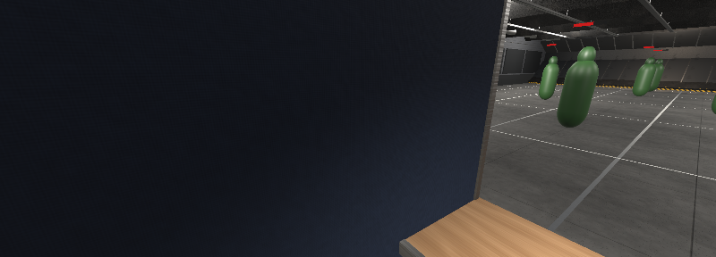
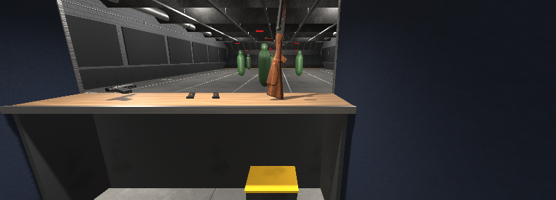
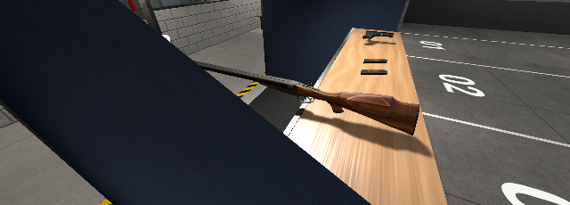

# GunShooting

## Unity VR Weapons & Equipment Simulator (SteamVR + Oculus)

A VR firearms-handling and equipment-training sandbox built in Unity 2022.3 (URP). It started from a VR weapons-training bachelor's thesis project ([Shooting Range VR](https://github.com/kaayran/ShootingRangeVR) by Anton Pokidov, MIT licensed) and has since been extended with original content: a break-action double-barrel shotgun and a "Zombie Corridor" survival mode.

## Gameplay Mechanics

### Double-Barrel Shotgun

---

An original addition: a break-action double-barrel shotgun with two independent, fixed grip points (rear/trigger and fore/barrel) instead of one free-form hold. Either grip can be used alone to carry and aim the gun, but the trigger only responds once both hands are bracing it — just like shouldering a real shotgun. It holds two shells, auto-reloads after a short delay once both are spent, and kicks both hands with haptic feedback on fire.

### Zombie Corridor (original mode)

---

A self-contained survival scene added on top of the base training sandbox. Press the start button to release a wave of zombies that wander within a bounded area; each one has its own health bar, flashes red on hit, and sinks out of the level when killed. A HUD displays prompts ("PRESS START TO RELEASE THE ZOMBIES") and the win state ("ALL CLEAR — PRESS START TO GO AGAIN") once every zombie is down. Any weapon that implements hit damage can be used to clear the corridor.
