# GunShooting

## Unity VR Weapons & Equipment Simulator (SteamVR + Oculus)

A VR firearms-handling and equipment-training sandbox built in Unity 2022.3 (URP). It started from a VR weapons-training bachelor's thesis project ([Shooting Range VR](https://github.com/kaayran/ShootingRangeVR) by Anton Pokidov, MIT licensed) and has since been extended with original content: a break-action double-barrel shotgun and a "Zombie Corridor" survival mode.

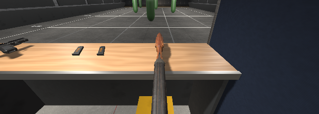

## Gameplay Mechanics

### Glock 17

---

Core handgun mechanics: shooting, reloading, and disarming/loading magazines on a Glock 17. It supports 4 different 9mm cartridge types, each with its own muzzle velocity, impact force, and behavior.

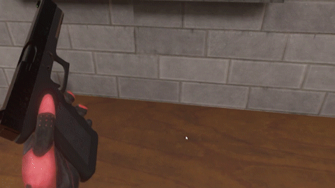

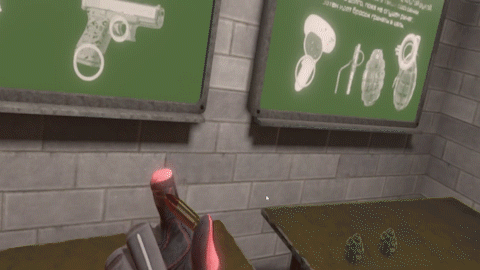

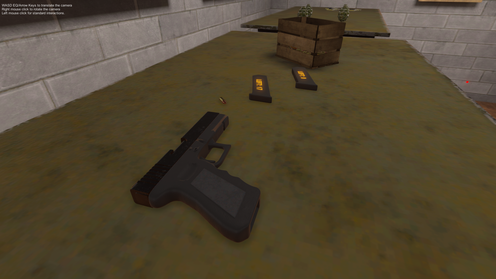

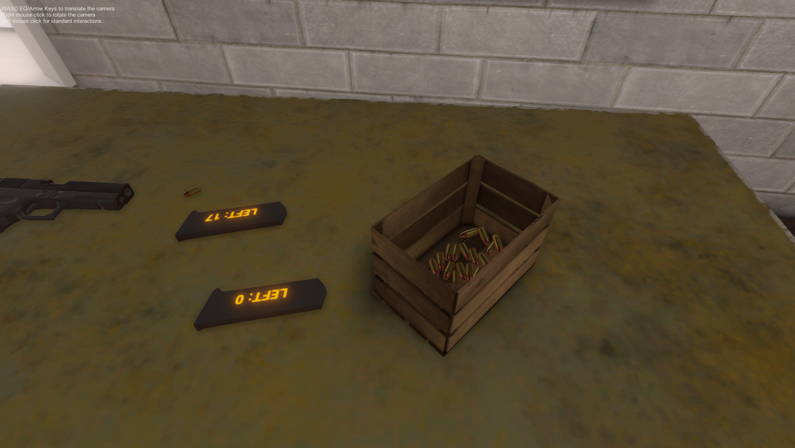

### Double-Barrel Shotgun

---

An original addition: a break-action double-barrel shotgun with two independent, fixed grip points (rear/trigger and fore/barrel) instead of one free-form hold. Either grip can be used alone to carry and aim the gun, but the trigger only responds once both hands are bracing it — just like shouldering a real shotgun. It holds two shells, auto-reloads after a short delay once both are spent, and kicks both hands with haptic feedback on fire.

### Grenade F-1

---

A Russian anti-personnel fragmentation defensive grenade with a "UZRGM" fuse: drag the ring, hold the lever. The fuse alone can be detonated independently of the main charge, producing a small blast with limited fragments and a bit of smoke. With the fuse seated, it becomes a live F-1 grenade — hold the lever, pull the ring, and throw. The explosion meaningfully affects nearby physics objects.

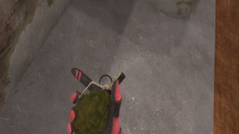

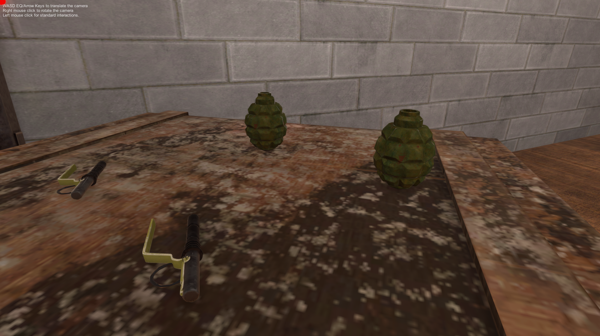

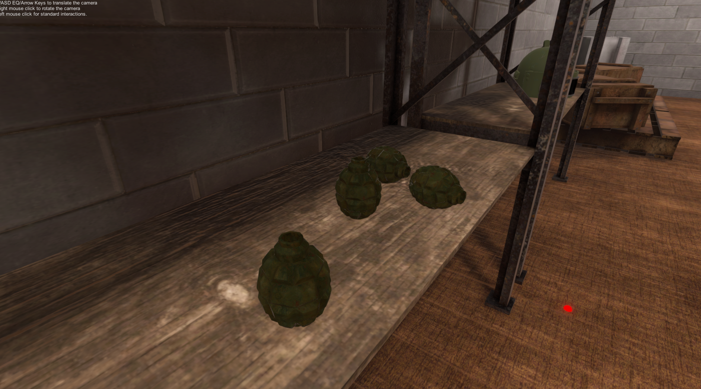

### Equipment

---

Two types of protective equipment: body armor and a military helmet. The helmet (Altyn) protects the head and face (when the visor is down) against fragments and small-caliber rounds, but it noticeably dampens outside sound once worn. The body armor (Gzhel) absorbs grenade fragments and dissipates bullet impact energy — a lightweight assault vest with ceramic plates.

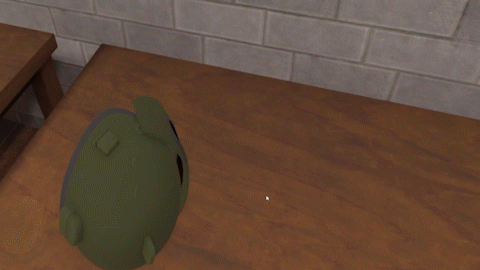

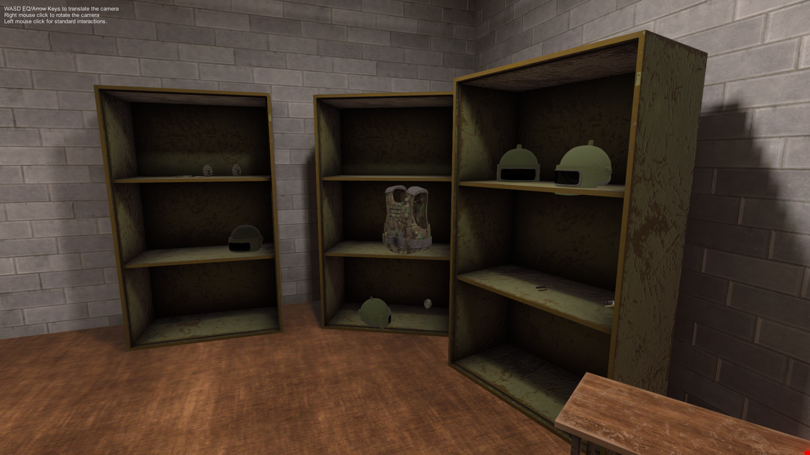

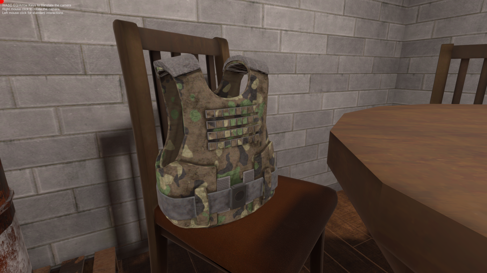

### Target Practice

---

Practice shooting on human-shaped targets in the Shooting Range. A wall-mounted remote control moves the target closer or farther away, and an accuracy panel on the wall tracks hits and total shots fired.

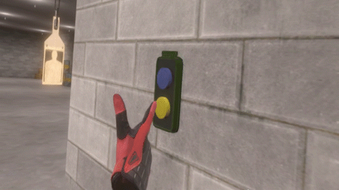

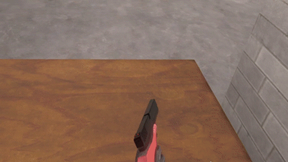

### Knife & Canned Food

---

As an extra touch, the "Anti-Terror" knife can pry open a can of Russian tinned meat — and you can taste it.

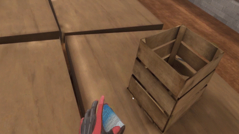

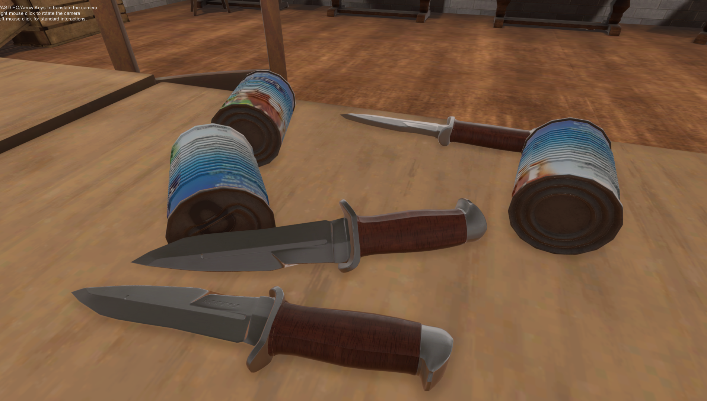

### Zombie Corridor (original mode)

---

A self-contained survival scene added on top of the base training sandbox. Press the start button to release a wave of zombies that wander within a bounded area; each one has its own health bar, flashes red on hit, and sinks out of the level when killed. A HUD displays prompts ("PRESS START TO RELEASE THE ZOMBIES") and the win state ("ALL CLEAR — PRESS START TO GO AGAIN") once every zombie is down. Any weapon that implements hit damage can be used to clear the corridor.

## Scenes

- **ShootingRange** — the main handgun/grenade/equipment training range
- **IndoorRange** — an indoor range layout for the double-barrel shotgun
- **ZombieCorridor** — the wave-survival mode

## Controller Bindings

You'll need to configure input bindings before playing. Pre-made bindings are provided for:

- [Oculus Quest 2](/ControllerBindings/shootings_range_vr_oculus_quest_2.json)
- [Valve Index](/ControllerBindings/shootings_range_vr_valve_index.json)

Allocate two buttons with a simple "Button" specialization (e.g. "A"/"B" and "X"/"Y" on Oculus). See the reference image below for the full binding layout.

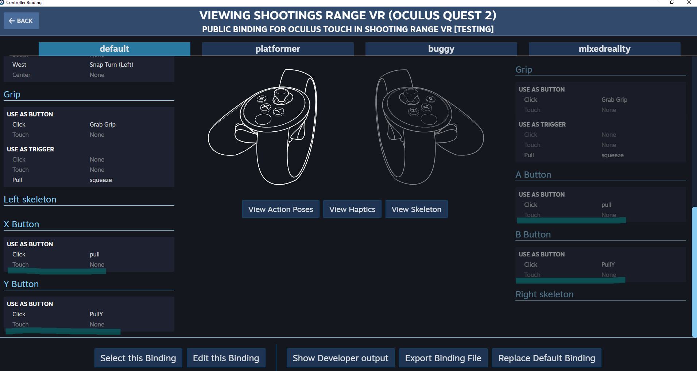

## Tech Stack

- Unity **2022.3.62f3** (Universal Render Pipeline)
- **SteamVR / OpenVR** interaction system
- **Oculus XR Plugin** for Quest support
- TextMesh Pro for in-game UI

## Credits & License

This project is built on top of [Shooting Range VR](https://github.com/kaayran/ShootingRangeVR) by Anton Pokidov, released under the MIT License. See [LICENSE](./LICENSE) for details.

## Releases

See the [Releases page](https://github.com/tak1117/GunShooting/releases) of this repository for downloadable builds.
